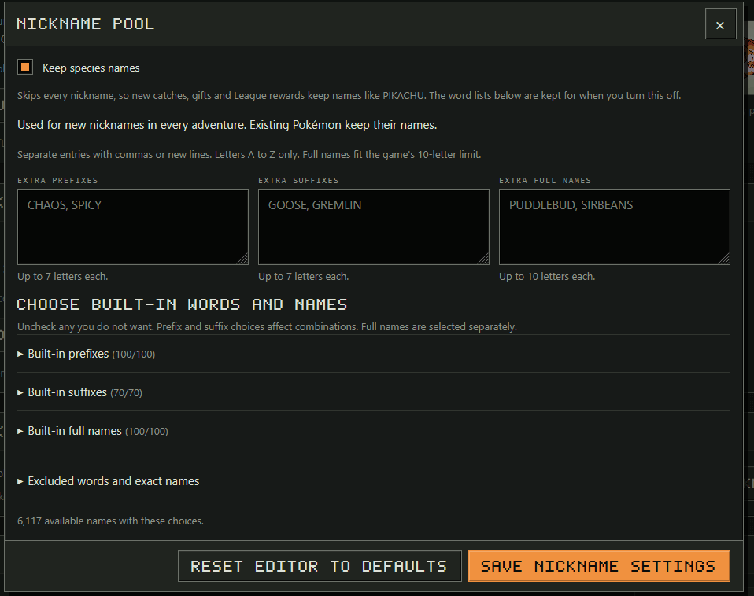
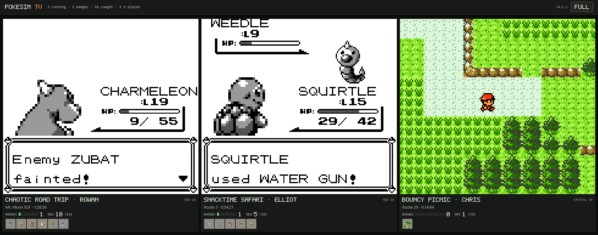

<h1 align="center">PokeSim · Noidea24 fork</h1>

<p align="center">
  A fork of <a href="https://github.com/afk-sapien/PokeSim"><b>afk-sapien/PokeSim</b></a> with a few optional features.<br>
  All credit for PokeSim itself goes to its author. <a href="#original-readme">Jump to the original README ↓</a>
</p>

> [!WARNING]
> **Beta.** These additions are new and only lightly tested. They pass the project's automated tests
> and have run on live Pokémon Red and Crystal games, but gift Pokémon, League rewards and long runs
> have not been watched end to end yet. Please report problems on
> [this fork's issues](https://github.com/Noidea24/PokeSim/issues), not upstream.

> [!NOTE]
> Each feature is **off or unused until you choose it**. With nothing turned on, the app behaves
> exactly like the original, and the save format is unchanged, so a library can move between this
> fork and the original in either direction.

## What this fork adds

### 1. Keep species names

Skips every nickname, so new catches, gifts and League rewards keep names like PIKACHU instead of
drawing from the nickname pool. Red, Blue and Yellow answer NO at the nickname prompt. Gold, Silver
and Crystal confirm a blank name, which the game turns into the species name. Existing Pokémon are
never renamed, and your word lists stay saved for when you turn it off.

**Turn it on:** Settings, **Edit nickname pool**, check **Keep species names**, save.<br>
**Tested:** starters and catches on live Red and Crystal runs.



### 2. TV view

Every running adventure on one screen, for a wall display, a spare monitor or a small kiosk. Each
tile shows the live game with its trainer, location, play time, badges, Pokédex count and party, and
the grid rearranges to give each game the most room. The pointer hides after three seconds and
**FULL** goes full screen.

All games' live video shares one connection, so even six or more stream smoothly while party
sprites and stats keep loading. For 4x and 8x games, set `STREAM_FPS=60` in the environment.

**Open it:** **TV view** in the Library, or `/tv`. Options such as `?ids=`, `?fps=`, `?stream=0&fps=1`
for a Raspberry Pi and `?info=0` are listed in [TV view options](docs/operations.md#tv-view).<br>
**Tested:** six live games across Red, Blue, Yellow, Gold, Silver and Crystal, plus browser tests at
TV, kiosk and phone sizes.



### 3. Dashboard stats

Read-only JSON for home dashboards such as Homepage or Home Assistant: library totals (running,
badges, caught, Hall of Fame, play time) and, for each adventure, its game, state, speed, trainer,
badges, Pokédex, money, location and party. The numbers come from reports the games already send,
so reading them costs nothing, and a stopped game keeps its last numbers.

**Read it:** `/api/v1/stats` for everything, `/api/v1/stats/<adventure id>` for one game. A
[Homepage card example](docs/operations.md#dashboard-stats) is in the docs.<br>
**Tested:** live games and automated tests.

### 4. Battle style (beta)

Before each gym leader and the League, the original trains until its best matchup scores 75 or the
team is 10 levels above the gym. In Yellow's late game that can mean hours on a route whose wild
Pokémon barely give experience. A battle style changes how cautious that is, per adventure:

| Style | Readiness wanted | Levels above the gym | Tries anyway after |
| --- | --- | --- | --- |
| **Balanced** (default) | 75 | 10 | never, as in the original |
| **Bold** | 55 | 5 | 30 game minutes of training |
| **Careful** | 85 | 15 | never |
| **Custom** | your number | your number | your number |

With a limit set, training and challenging take turns in stretches of that length until the badge
is won. Gold, Silver and Crystal only train before Falkner, so there it mostly changes that.

**Set it:** stop the adventure, open its settings, choose **Battle style (beta)**, save.<br>
**Tested:** automated tests of every gate, including a Sabrina case like a stalled Yellow run.

### 5. Priorities (beta)

Once the story is done, the bot picks what to do next by tier: new Pokédex entries, then the
marathon, then upgrades (training, level 100s, perfect and better copies), then filler such as
exploring. Story, healing and supplies always come first. Priorities reorder those four tiers and
scale how often Red, Blue and Yellow wander, explore or stop to chat:

| Priorities | Order after the story | Wandering |
| --- | --- | --- |
| **Balanced** (default) | new entries, marathon, upgrades, filler | as in the original |
| **Collector** | new entries, upgrades, marathon, filler | half |
| **Trainer** | upgrades, new entries, marathon, filler | half |
| **Explorer** | new entries, filler, marathon, upgrades | about twice |

The original already puts new entries first, so Collector differs from Balanced only a little.
Gold, Silver and Crystal do not wander, so there only the order changes.

**Set it:** stop the adventure, open its settings, choose **Priorities (beta)**, save.<br>
**Tested:** automated tests of the order and wandering for every choice.

### Smaller fixes and settings

- `STREAM_FPS` (up to 60) now sets every game's live picture rate, not only the Library's.
- `TRADE_PREPARE_SECONDS` limits how long two games may walk to the Cable Club before a trade is
  called off, scaled by game speed. See [Trade preparation limit](docs/operations.md#trade-preparation-limit).
- The TV view reconnects by itself after trades, and quiet live streams close without an error.

## Running the fork

Use `ghcr.io/noidea24/pokesim:latest` in place of `ghcr.io/afk-sapien/pokesim`. Every push to `main`
rebuilds it for amd64 and arm64. To go back, switch the image back. Your saves work with both.

**What changed in the code:** nickname handling in both generations' naming code, League reward and
Mew gift naming, one new setting saved with the nickname settings, `pokesim/dashboard.py` and two
read-only routes, the TV page (`tv.html`, `tv.js`, `tv.css`), a checkbox and a link in the Library,
tests for each, and the workflow that builds this image. Nothing else is changed. The full list is in
[CHANGELOG.md](CHANGELOG.md).

<br>

---
---

<a id="original-readme"></a>
<h1 align="center">Original README</h1>
<p align="center"><i>Everything below this line is afk-sapien's README for PokeSim, unchanged.</i></p>

---

# PokeSim

**Pokémon Red, Blue, Yellow, Gold, Silver and Crystal that play themselves while you're away.**


Watch an automatic player catch Pokémon, earn badges and challenge the League in
your browser. Take control whenever you like, then hand the adventure back.
Everything runs locally, with no model API or subscription.

**Bring your own legally dumped ROMs. None are included, and PokeSim never downloads them.**

## Quickstart

On an x86-64 or 64-bit ARM machine with Docker Compose:

```sh
curl -fL --retry 3 --create-dirs -o pokesim/compose.yaml https://github.com/afk-sapien/PokeSim/releases/latest/download/compose.quickstart.yaml
cd pokesim
docker compose up -d --wait
```

Open [localhost:8930](http://localhost:8930), add your ROM in Settings → Game cartridges
and create an adventure. Other platforms and the desktop install are under [Install](#install).

**Hardware:** each running adventure is one process. At 4x speed it uses 5 to 20% of one
CPU core, about 300 MB of RAM for Red, Blue or Yellow and about 150 MB for Gold, Silver or
Crystal. Max speed can use a full core. The Library itself needs about 170 MB.

## Keep the adventure going

- **Many games side by side:** Run any mix of Generation I and II adventures, each with
  its own saves and speed. Check CPU, memory and observed speed in the Library.
- **A growing collection:** Explore the Pokédex and search every PC box. Compare
  power, types and DV quality to find promising Pokémon.
- **They trade with each other:** Adventures meet in the in-game Cable Club and
  exchange Pokémon over a virtual link cable, including trade evolutions. Generation I
  and II games trade with each other through the Time Capsule.
- **Milestones and stats:** Follow catches, League wins, collection strength and
  marathon personal bests in the Journal.
- **Life after the League:** Keep training, rotate League teammates, revisit
  eligible encounters and earn new Pokémon.
- **Your own touch:** Add nickname prefixes and suffixes, take over the controls,
  or export your save to continue in another emulator.

| Journal entries | Adventure stats |
| --- | --- |
| [](docs/images/journal-panel.jpg) | [](docs/images/stats-panel.jpg) |

## Generation I: Red, Blue and Yellow


Red and Blue adventures play the Kanto story to the Hall of Fame and keep going.
Yellow starts with Pikachu and follows its own story, including Jessie and James
and the gift starters. Exports are a standard `.sav`.

## Generation II: Gold, Silver and Crystal

Gold, Silver and Crystal adventures earn all 16 badges, beat Red and work toward the
251-species Pokédex, with breeding, held items and roaming beasts. Crystal adds the
Battle Tower and an optional Celebi event.

The cartridge clock that decides day, night and weekday events runs on game time. At 1x
it keeps pace with a console, and at Max the days pass as fast as the run plays. Exports
are a `.zip` holding the `.sav` and its `.rtc` clock file. Put both next to the ROM.
[How the clock works](docs/guide.md) and [cartridge details](docs/gen2-exploration.md).

## The collection is half the fun

Want every species? Run more than one game and let them trade version exclusives
and trade evolutions automatically, across generations too. New adventures created in the
Library have these rewards and return visits **enabled by default**, so the collection
keeps growing beyond the original games' one-time encounters:

- **Another Eevee, another fossil (Generation I):** After becoming Champion and
  unlocking the original events, revisit gifts, fossils, the Fighting Dojo and
  supported NPC trades after **100,000 steps** by default.
- **Legendary rematches:** Previously acquired legendary birds and Mewtwo, or
  the legendary beasts, Lugia and Ho-Oh, return to be caught again every
  **1,000,000 steps** by default. Sudowoodo and Snorlax return in Generation II too.
- **A mythical reward:** A custom Mew gift arrives in the PC after your first
  League win. Mew isn't normally obtainable in these games. Another
  million steps followed by a new League win earns another.
- **More starters:** Receive a random Kanto starter in Generation I, or a random
  Johto starter in Generation II, after each new League win.

Change or disable these rewards in each adventure's settings.
[How return visits work](docs/step-rewards.md).

| Pokédex | PC collection |
| --- | --- |
| [](docs/images/pokedex-panel.jpg) | [](docs/images/pc-panel.jpg) |

## A few extras for the long run

- **Meet WAFFLEKING:** 6,117 built-in nicknames, plus your own prefixes
  and suffixes. Every collection deserves a few questionable names.
- **Milestones in your pocket:** Catch updates and adventure screenshots through
  ntfy, Discord or Telegram.
- **The Kanto Marathon:** Sometimes the next big goal is a run around Kanto.
  Follow the race and see whether your trainer beats their personal best.

Follow the [changelog](CHANGELOG.md) for new additions.

## Your adventure library

Manage games in one place, with live screens, recent activity, CPU and memory
usage, and the speed each simulation is actually reaching. Each game you own gets
one cartridge slot in Settings → Game cartridges. Drop a ROM on any slot and PokeSim
recognises the game and files it in the right one. New adventure then lets you pick
from the cartridges you have installed.


## Install

Bring your own supported Pokémon Red, Blue, Yellow, Gold, Silver or Crystal ROM that you are
entitled to use. Supported builds are English USA/Europe, with Crystal Rev 1.
Professor Oak supplies starters, not ROMs. PokeSim does not
include or download ROMs. Your ROM stays on the machine running PokeSim.

### Server: Docker Compose

The [quickstart](#quickstart) creates a `pokesim` folder holding `compose.yaml`.
On Windows PowerShell, use `curl.exe`. Docker keeps your library in a persistent
volume. Keep this folder for future Compose commands.

**Already installed?** Keep your existing Compose file and data mount. Back up
before upgrading, since Yellow, Gold, Silver and Crystal adventures cannot be opened by
earlier releases. See [update and roll back](docs/operations.md#update-and-roll-back). The [self-hosting guide](docs/self-hosting.md) covers updates,
remote access and custom ports.

### Desktop: install with uv

Install [uv](https://docs.astral.sh/uv/getting-started/installation/) using your
package manager:

| Platform | Command |
| --- | --- |
| Windows with WinGet | `winget install --id astral-sh.uv --exact` |
| macOS with Homebrew | `brew install uv` |
| Linux with pipx | `pipx install uv`, then `pipx ensurepath` |

Open a new terminal, then install the current public release:

```sh
uv tool install --python 3.12 --managed-python https://github.com/afk-sapien/PokeSim/releases/download/v0.6.2/pokesim-0.6.2-py3-none-any.whl
uv tool update-shell
```

Open another terminal and run `pokesim-desktop`. It opens the Library in your
browser. uv manages Python for you. See the [desktop guide](docs/desktop.md) for
package-manager prerequisites, updates and removal.

Games continue after you close the browser tab. Keep the host awake and use
**Save and quit** to stop cleanly. The Library has no login, so anyone who can
reach it can manage it. Default installations bind to localhost. Never expose it
directly to the internet. For remote access, put it behind something that adds
authentication, such as Tailscale, Cloudflare Access, or your own reverse proxy with
a login.

## Help and documentation

Adventures can reach the Hall of Fame, but the automatic player can still get stuck.
See [release status and known limits](RELEASE_STATUS.md).

- [Gameplay and notifications](docs/guide.md)
- [Statistics and counting rules](docs/adventure-statistics.md)
- [Backups and troubleshooting](docs/operations.md)
- [Authentication and view links](docs/authentication.md)
- [Report a bug or request a feature](https://github.com/afk-sapien/PokeSim/issues)
- [Discussions](https://github.com/afk-sapien/PokeSim/discussions) and [contributing](CONTRIBUTING.md)
- [Security](SECURITY.md) and [community guidelines](CODE_OF_CONDUCT.md)

PokeSim is an unofficial fan project, unaffiliated with Pokémon's rights holders.
Code is [MIT licensed](LICENSE). ROMs and generated game data are not distributed.
AI coding assistance was used during development. The automatic player uses local
rules. See [third-party notices](THIRD_PARTY_NOTICES.md) and [dependency licenses](docs/licensing.md).
